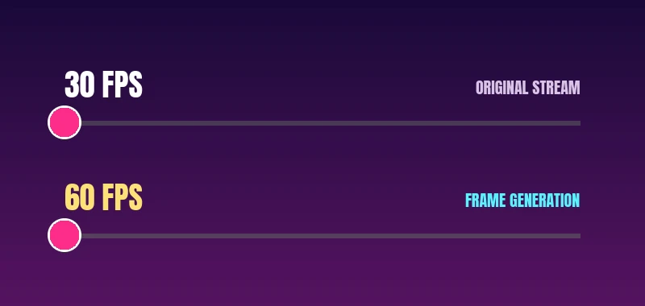
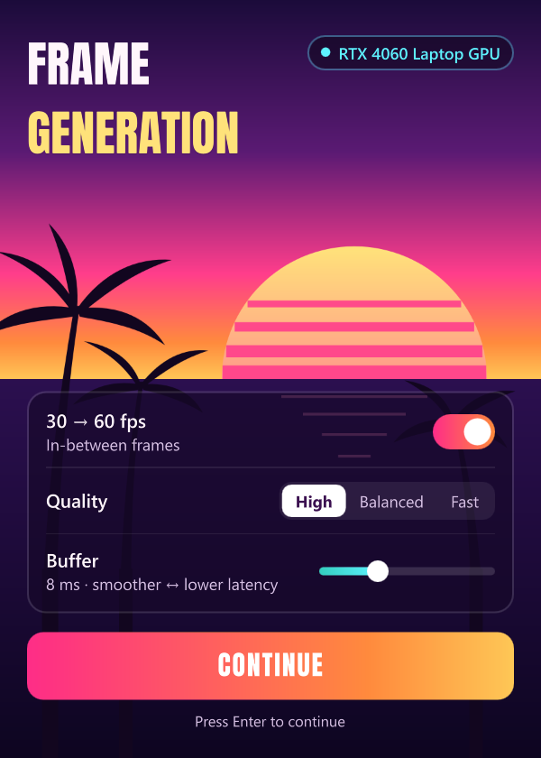

# chiaki-ng-60fps

**Play Grand Theft Auto VI at 60 fps on your PC.** GTA VI runs at 30 fps on PS5; this fork of [chiaki-ng](https://github.com/streetpea/chiaki-ng) streams it to your PC and doubles it to **60 fps** with GPU optical-flow frame generation.

That is the main goal of the project. It works the same way with any other 30 fps PS5 game.

Illustration: the same motion at a true 30 vs 60 fps (animated WebP). In-game footage will follow.

## What it does

- Every second frame on screen is **generated**: the GPU's optical flow engine estimates motion between two decoded frames and a compute shader warps and blends them into the in-between frame.
- Everything stays on the GPU (zero-copy Vulkan video decode → optical flow → shader → present).
- Latency: measured on an RTX 4060 Laptop at 1080p30, a real frame reaches the screen ~21 ms after it is decoded with frame generation on (default buffer 0 ms), versus ~34–43 ms with it off (the stock path paces presents to the stream interval). The optional jitter buffer adds its value on top.
- When frame generation is off, the code path is the same as upstream chiaki-ng.

## Download

Get `chiaki-ng-60fps-setup.exe` from [Releases](https://github.com/SalihKocaturk/chiaki-ng-60fps/releases). It installs next to an upstream chiaki-ng without replacing it and shares its settings and registered consoles.

The installer is not code-signed yet, so Windows SmartScreen may warn on first run (*More info → Run anyway*).

## Requirements

- Windows, Vulkan renderer, *Direct Mapping* frame delivery (the default).
- **NVIDIA RTX 20 series or newer** (needs `VK_NV_optical_flow`). Other GPUs run normally at 30 fps; support for them is planned.
- Set the stream to **30 fps** in the PS5 settings of the app.

Tested on an RTX 4060 Laptop GPU, 1080p30, 240 Hz display, playing Grand Theft Auto VI.

## Using it

- A small window opens before the app: turn **Frame Generation** on or off, pick **Quality** (High / Balanced / Fast) and the **Buffer** (more = smoother on a jittery network, more latency). Press **Continue** or Enter.
- The same options are in *Settings → Video*.
- With *Show stream stats* on, the overlay shows the output fps and how many frames were generated.
- The launch window is available in English, Türkçe, Deutsch, Español, Français, Português (Brasil), Italiano, Русский, 日本語 and 简体中文.

## Building (Windows)

Built with clang-cl + vcpkg following `.github/workflows/build-windows-x86.yml`, plus Qt 6, the Vulkan SDK and libplacebo. The helper scripts are in `scripts/windows-framegen/` (`build.ps1 placebo|configure|build|deploy`; they expect to sit in a `tools/` folder next to the `chiaki-ng` checkout). The installer is built from `scripts/chiaki-ng-60fps.iss` with Inno Setup 6.

## License and credits

- AGPL-3.0, like chiaki-ng. Source for every build is in this repository. Bundled third-party libraries are listed in `scripts/windows-framegen/THIRD-PARTY.txt`.
- Title font: [Anton](https://github.com/googlefonts/AntonFont) — SIL Open Font License 1.1 (`gui/res/fonts/OFL.txt`).
- Not affiliated with or endorsed by Sony Interactive Entertainment or Rockstar Games. The launch window art is original.

## Launch window

---

*The upstream chiaki-ng README follows. Its download links point to upstream builds, which do not include frame generation.*

# [chiaki-ng](https://chiaki-ng.github.io/chiaki-ng/)

An open source PlayStation remote play project serving as the next-generation of Chiaki with improvements and ongoing support now that the original Chiaki project is in maintenance mode only. [Click here to see the accompanying site for documentation, updates and more](https://chiaki-ng.github.io/chiaki-ng/).

## Discord
[chiaki-ng community Discord](https://discord.gg/tAMbRuwXDH)

## Official downloads
Only download chiaki-ng from these sources:

- [GitHub Releases](https://github.com/chiaki-ng/chiaki-ng/releases)
- [Flathub](https://flathub.org/apps/io.github.streetpea.Chiaki4deck)
- winget: `winget install --id=StreetPea.chiaki-ng -e`
- Homebrew: `brew install --cask streetpea/streetpea/chiaki-ng`

Other websites offering chiaki-ng downloads, such as chiaki-ng.com, are not run by this project, and we can't vouch for the files they serve.

## Disclaimer
This project is not endorsed or certified by Sony Interactive Entertainment LLC.

Chiaki is a Free and Open Source Software Client for PlayStation 4 and PlayStation 5 Remote Play
for Linux, FreeBSD, OpenBSD, Android, macOS, Windows, Nintendo Switch and potentially even more platforms.
